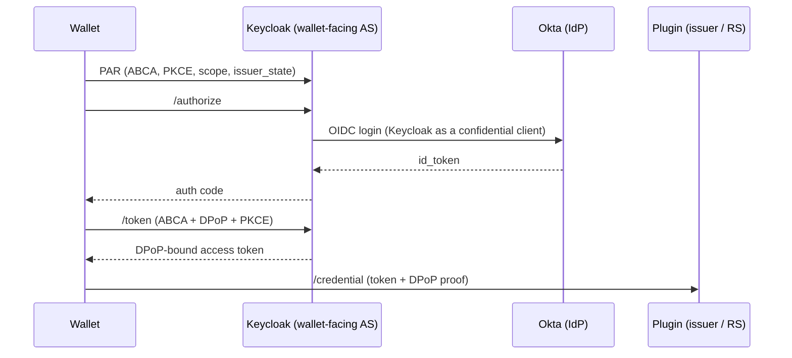

# Pluggable authorization servers

The OID4VC plugin is always the **Credential Issuer** and the **resource
server** for `/credential`. It also owns the pre-authorized code flow: offers,
codes, `tx_code` and exchange state. The wallet-facing OAuth authorization
server, which issues access tokens, is pluggable.

## Providers

`oid4vc/auth_providers/` defines `AuthServerProvider`. An
`AuthServerRegistry`, bound in the injector, maps an authorization server
entry's `type` to a provider. This is the same pattern `CredProcessors` uses
for credential formats.

| `type` | Provider | Package | Pre-authorized code | Access token validation | Exchange key |
|---|---|---|---|---|---|
| `builtin` | `BuiltinProvider` | `oid4vc` | random, minted by the plugin | `jwt_verify`, signed with the tenant's own `did:jwk` | `sub` |
| `reference` | `ReferenceProvider` | `oid4vc` | `POST {private_url}/grants/pre-authorized-code` | RFC 7662 introspection | `sub` |
| `keycloak` | `KeycloakProvider` | `oid4vc_keycloak` (separate plugin, `keycloak/`) | random, minted by the plugin, redeemed by Keycloak | local, realm JWKS (`iss`, `aud`, `exp`) | `refresh_id` claim |

Selection (`resolve_auth_provider`), highest priority first:

1. the tenant's `IssuerConfiguration.authorization_servers[0]`;
2. the plugin-level `oid4vci.auth_server` / `OID4VCI_AUTH_SERVER`;
3. `builtin`.

An entry without `type` means `reference`, for backward compatibility.

Each provider covers these parts of the flow:

| Hook | Used by |
|---|---|
| `create_pre_authorized_code` | `routes/helpers.py` `_parse_cred_offer` (offer creation) |
| `validate_access_token` | `public_routes/token.py` `check_token` |
| `exchange_key` | `check_token` → `AccessTokenResult.exchange_key` → `/credential` |
| `require_dpop` | `check_token` |
| `authorization_servers` | issuer metadata, `openid-configuration` |
| `serves_token_endpoint` | the plugin `/token` (only `builtin`); `token_endpoint` in the metadata |
| `supports_redeem`, `authenticate_back_channel` | `POST /oid4vci[/tenant/{wallet_id}]/pre-auth/redeem` (admin API) |

## Shared, provider-independent pieces

- **`dpop.py`**: DPoP proof verification per RFC 9449 §4.3. It checks:
  - `typ`, an asymmetric `alg`, and a public-only `jwk`;
  - the signature;
  - `htm`, and `htu` against the *configured public* URL rather than the
    `Host` header, which differs behind proxies;
  - the `iat` window, `ath`, and that the key thumbprint equals `cnf.jkt`;
  - single-use `jti`.

  `check_token` applies it to every token bound with `cnf.jkt`, and rejects a
  bound token sent with the `Bearer` scheme. The built-in `/token` uses the
  same verifier to bind the tokens it issues.
- **`jose_util.py`**: JWS verification against a bare JWK (RS/PS/ES/EdDSA,
  using `cryptography`; askar only supports EdDSA/ES256), RFC 7638 thumbprints,
  a JWKS cache and a replay cache.
- **`auth_providers/client_auth.py`**: OAuth client authentication for
  back-channel calls *from* an authorization server (`private_key_jwt`,
  `client_secret_jwt`, `client_secret_post`). It mirrors the methods the
  reference authorization server accepts from the plugin, in the other
  direction. Credentials go in the form body, because on the admin port in
  multitenant mode ACA-Py reserves `Authorization` for tenant tokens.
- **`pre_auth.py`**: `redeem_pre_auth_code`, used by both the built-in
  `/token` and the redeem endpoint. In one transaction it checks the code is
  single use, compares the `tx_code` in constant time, and enforces a
  failed-attempt limit (`max_tx_code_attempts`, default 5). Each exchange has
  one code, so a locked code needs a new exchange.

## Keycloak

See [`keycloak/README.md`](../keycloak/README.md). In short, a small Keycloak
extension registers a custom grant type for
`urn:ietf:params:oauth:grant-type:pre-authorized_code`. It runs ABCA and
requires DPoP. It then redeems the plugin's code and issues a DPoP-bound token
for a generic holder user in a transient session. Keycloak's experimental
OID4VC features are not used.

Redemption is a trusted backend call, so the redeem endpoint is on the
plugin's **admin API**, not the public OID4VCI port. Keycloak authenticates as
an OAuth client of the plugin (default `private_key_jwt` with the realm key,
verified against the realm JWKS), not with ACA-Py admin credentials:

- a tenant token would give Keycloak everything the tenant can do;
- ACA-Py keeps one valid token per tenant, so Keycloak and the controller
  would share it and a token refresh would break Keycloak.

Keycloak also issues long-lived refresh tokens (default one year) without
storing sessions. They are self-contained, bound to the wallet's DPoP key (or
attested instance key) and rotated on each use, following the design of
Keycloak's own OID4VCI refresh tokens. A refreshed token only yields a
credential if the controller has opened a new exchange for its `refresh_id`;
credential revocation stays with the token status list.

One endpoint serves every tenant. As elsewhere on the ACA-Py admin API, the
tenant is carried in the authentication, not the path: the realm names the
credential issuer it acts for in a `credential_issuer` claim of its signed
client assertion. The plugin maps that to the base wallet or a tenant,
verifies the assertion against *that* tenant's Keycloak entry, and checks the
verified claim. A realm can only redeem codes for the tenant whose
configuration trusts it. (The reference authorization server selects the
tenant by URL path, `/tenants/{uid}`, but there only its operator registers
clients; here tenants manage their own configuration, so the tenant must come
from what the realm signs.)

### Why the code stays opaque and is redeemed by the plugin

A plugin-signed JWT code, verified locally by Keycloak with no runtime call
to the plugin, was considered and rejected because of `tx_code`. Anything in
the code that lets someone *test* a guess, such as a salted hash, defeats
`tx_code` against exactly the threat it exists for. Someone who scanned the QR
code over the user's shoulder (OID4VCI §13.6) could brute-force a 6-digit PIN
offline in under a second. A signed code would only be safe with a secret
shared between the plugin and Keycloak, which isn't worth the key management.

| | Opaque code + redemption (chosen) | Plugin-signed JWT code (rejected) |
|---|---|---|
| `tx_code` | Checked by the plugin, attempt-limited | Cannot be embedded safely |
| Single use / revocation | Plugin exchange record | Keycloak `jti` store; revoke by expiry only |
| Offer size | Short | Long (needs `credential_offer_uri`) |
| Runtime coupling | Keycloak → plugin call per token request | None |

### Approaches that don't fit

- **The plugin proxying the token request to the AS.** The DPoP proof `htu`
  and the attestation PoP `aud` are bound to the server the wallet talks to.
- **Keycloak's `jwt-bearer` grant** (RFC 7523), possibly behind a gateway
  that rewrites the grant type. It needs a confidential client, an identity
  provider entry, and a user that already exists and is linked by federated
  identity. Keycloak does not know the holder.
- **Keycloak's own pre-authorized code grant.** It needs its own offer state,
  a real user, and the experimental OID4VC features.
- **Client-driven token exchange** (RFC 8693 followed by RFC 7523).
  OID4VCI wallets send exactly one pre-authorized code token request to the
  AS listed in `authorization_servers`.

## Future: authorization code flow

The authorization code flow with an upstream IdP uses standard
Keycloak identity brokering, with **no custom grant type**:

- **The IdP** is registered once as an OIDC identity provider in Keycloak and
  never sees the wallet. An *Identity Provider Redirector* step skips
  Keycloak's own login page.
- **Users:** first-broker-login auto-creates a linked shadow user. That is
  fine here because the IdP knows who the user is. IdP mappers copy the IdP claims
  into the token.
- **DPoP, ABCA, PKCE and PAR** are all native Keycloak features for this
  flow.

Gaps found in the Keycloak source:

1. **`authorization_details`:** with `oid4vc-vci` off, Keycloak's own
   `openid_credential` processor is not loaded. The extension registers one,
   but it checks entries against what a redeemed pre-authorized code grants,
   so it only serves that grant. For the authorization code flow it would
   need to check entries against the plugin's credential configurations
   instead (or wallets request credentials by `scope`, each configuration
   then needs a `scope`, and `/credential` falls back to it).
2. **`issuer_state`:** Keycloak stores it as the *client*-session note
   `client_request_param_issuer_state`. The built-in User Session Note mapper
   only reads *user*-session notes, so a small custom mapper is needed.

Binding the identity to the credential data:

- **Issuer-initiated** (an offer with `issuer_state` = exchange id): the plugin
  **must** check that the IdP identity in the token matches the exchange's
  subject. Otherwise anyone who intercepts the offer can log in as themselves
  and collect someone else's credential.
- **Wallet-initiated:** no exchange exists yet. The plugin creates one from
  the token identity, for example through a controller callback that supplies
  the subject's data.

If users already authenticate through an IdP-protected portal, that portal
can simply issue a pre-authorized code offer. The authorization code flow
mainly adds value for wallet-initiated issuance.

## References

- OpenID4VCI 1.0: Credential Offer `tx_code`; §13.6 Pre-Authorized Code Flow
  security
- RFC 9449 (DPoP), RFC 7638 (JWK Thumbprint), RFC 8414 (AS Metadata),
  RFC 7662 (Introspection), RFC 8693, RFC 7523, RFC 9396
- draft-ietf-oauth-attestation-based-client-auth
- Keycloak 26.8 source: `TokenEndpoint`, `DPoPUtil`, `OAuth2GrantTypeBase`,
  `ClientCredentialsGrantType`, `PreAuthorizedCodeGrantType`,
  `AttestationBasedClientAuthenticator`, `DefaultTrustIdentityProvider`
