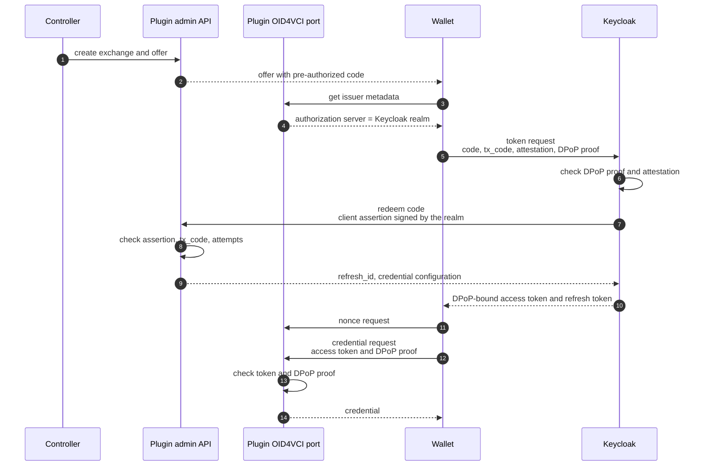
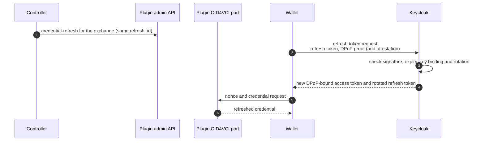

# Keycloak as the OID4VCI authorization server

This plugin and Keycloak extension enable Keycloak to act as the
wallet-facing OAuth authorization server for the OID4VC plugin's
**pre-authorized code flow**. Keycloak checks wallet attestation
(attestation-based client authentication, "ABCA") and DPoP.
The plugin stays the Credential Issuer and the resource server, and keeps
ownership of the offer, the pre-authorized code, the `tx_code` and the
exchange.

Keycloak's experimental digital-credential features (`oid4vc-vci`,
`oid4vc-vci-preauth-code`) are **not** used. The extension also does not need
a Keycloak user per holder.

| Path | What |
|---|---|
| [`extension/`](extension) | Keycloak extension: a custom grant type for `urn:ietf:params:oauth:grant-type:pre-authorized_code` (Java, Keycloak 26.8.0) |
| [`oid4vc_keycloak/`](oid4vc_keycloak) | ACA-Py plugin that registers the `keycloak` authorization server provider with the OID4VC plugin |
| [`Dockerfile`](Dockerfile) | Keycloak image with the extension installed and the required features enabled |
| [`e2e/`](e2e) | End-to-end test: Keycloak + issuer + a scripted wallet |
| [`../demo-keycloak`](../demo-keycloak/README.md) | The UI demo with Keycloak as its authorization server |

## How it works



Why it is split this way:

- **The plugin owns the code and the `tx_code`.** The code is an opaque random
  string. Nothing in it lets anyone test a `tx_code` guess offline. Guesses can
  only be made online through Keycloak, and the plugin locks the code after
  `max_tx_code_attempts` failures (default 5).
- **Keycloak authenticates the wallet and binds the token.** The extension
  calls `checkClient()` (Keycloak's token endpoint skips it for this grant
  type), which runs the ABCA authenticator. It then requires the DPoP proof
  that Keycloak has already validated. Keycloak's DPoP protocol mapper adds
  `cnf.jkt` to the token.
- **Redemption is a trusted back channel.** Keycloak redeems the code on the
  plugin's **admin API**, not the public OID4VCI port. It authenticates as an
  OAuth client of the plugin (see [Redeem endpoint](#redeem-endpoint)), so it
  never holds ACA-Py admin credentials.
- **No per-holder users or sessions.** Every token is issued for one generic
  `oid4vci-holder` user in a *transient* session; nothing is persisted. The
  exchange is identified by the `refresh_id` claim (configurable), not `sub`.
- **Long-lived, key-bound refresh tokens.** The wallet also gets a refresh
  token (default lifetime one year), bound to its key and rotated on every
  use. See [Refresh tokens](#refresh-tokens).
- **The code is redeemed only after client authentication and DPoP pass**, so
  an unauthenticated request cannot burn a code or use up a `tx_code` attempt.

## Configuring Keycloak

### 1. Build and install the extension

```bash
cd oid4vc/keycloak/extension
mvn -B package
cp target/keycloak-oid4vci-pre-auth.jar /opt/keycloak/providers/
```

Or build the image in [`Dockerfile`](Dockerfile) (`docker build oid4vc/keycloak`).

The extension uses Keycloak's grant type and refresh token SPIs
(`OAuth2GrantTypeSpi`, `RefreshTokenSpi`), which are **internal** to Keycloak
and may change between releases. Keep the Keycloak version pinned
(`keycloak.version` in `pom.xml`, currently 26.8.0) and re-test on every
upgrade (see [Integration tests](#integration-tests)). Keycloak logs a warning
at startup that the SPI is internal; this is expected.

The extension registers four providers:

| Class | SPI | Provider id |
|---|---|---|
| `OID4VCIPreAuthGrantTypeFactory` | grant type | `urn:ietf:params:oauth:grant-type:pre-authorized_code` |
| `OID4VCIPreAuthRefreshTokenProviderFactory` | refresh token | `acapy-oid4vci-pre-auth` |
| `OID4VCIRefreshClientHintAuthenticator` | client authenticator | `oid4vci-refresh-client-hint` |
| `OID4VCIAuthorizationDetailsProcessorFactory` | authorization details (RFC 9396) | `openid_credential` |

### 2. Server features

| Feature | Setting | Why |
|---|---|---|
| `dpop` | on (Keycloak default) | DPoP proof validation and `cnf.jkt` binding |
| `client-auth-abca` | **on** (experimental) | Wallet attestation. Required by default; see `oid4vci.require.client.attestation` |
| `oid4vc-vci-preauth-code` | **off** | Registers a grant type with the same id as this extension |
| `oid4vc-vci` | **off** | Registers an `openid_credential` authorization details processor with the same id as this extension's |

```bash
kc.sh build --features=client-auth-abca,dpop
```

With `start-dev`, Keycloak re-runs the build at startup, so set the features
(`KC_FEATURES`) in the runtime environment too.

The extension logs a warning at startup if `oid4vc-vci-preauth-code` or
`oid4vc-vci` is enabled, or `client-auth-abca` is disabled.

The realm issuer URL appears in the access token `iss`, the ABCA PoP `aud`
and the redeem client assertion. Either set a fixed hostname (`KC_HOSTNAME`),
or, behind a reverse proxy, use `--proxy-headers=xforwarded` so the issuer
follows the public host the wallet used. Wallet-facing requests must all see
the same issuer.

### 3. Realm

Use one realm per issuer tenant. All settings are realm attributes, so each
realm can point at its own plugin tenant.

Realm attributes aren't shown in the Keycloak admin console. Set and inspect
them through a realm import (`attributes` in the realm JSON), the admin REST
API, or `kcadm.sh`, for example:

```bash
kcadm.sh update realms/oid4vci -s 'attributes."oid4vci.redeem.url"=http://issuer:3001/oid4vci/pre-auth/redeem'
kcadm.sh get realms/oid4vci --fields attributes
```

| Realm attribute | Default | Meaning |
|---|---|---|
| `oid4vci.redeem.url` | — (required) | The plugin's redeem endpoint on its **admin API**, e.g. `http://issuer:3001/oid4vci/pre-auth/redeem`. The same endpoint serves every tenant. |
| `oid4vci.redeem.client.auth` | `private_key_jwt` | How Keycloak authenticates to the redeem endpoint: `private_key_jwt` (client assertion signed with the realm key), `client_secret_jwt` or `client_secret_post` |
| `oid4vci.redeem.client.id` | the realm issuer URL | Client id presented to the plugin |
| `oid4vci.redeem.client.secret` | unset | Secret for the `client_secret_*` methods. Can be a vault reference, e.g. `${vault.oid4vci-redeem}` |
| `oid4vci.credential.issuer` | — (required) | The plugin tenant's Credential Issuer Identifier (`credential_issuer` in the offer). Added to the access token `aud`, and names the tenant in redeem requests. |
| `oid4vci.require.client.attestation` | `true` | Require ABCA. When `false`, wallets that present no client authentication use the anonymous client. |
| `oid4vci.anonymous.client.id` | unset | Public client used for wallets that present no client authentication. Honoured only when attestation is not required. |
| `oid4vci.require.dpop` | `true` | Require a DPoP proof on the token request. |
| `oid4vci.holder.username` | `oid4vci-holder` | The generic holder user. |
| `oid4vci.refresh.id.claim` | `refresh_id` | Access token claim that carries the plugin exchange's `refresh_id`. |
| `oid4vci.redeem.timeout.ms` | `5000` | Timeout for the redeem call. |
| `oid4vci.refresh.tokens` | `true` | Issue refresh tokens. |
| `oid4vci.refresh.token.lifespan` | `31536000` (1 year) | Refresh token lifetime in seconds. Absolute: rotated tokens keep the first token's expiry. |

Realm settings:

- **Revoke refresh token** on, with **maximum reuse** `0`
  (`revokeRefreshToken: true`, `refreshTokenMaxReuse: 0`), so refresh tokens
  rotate.
- **Access token lifespan** short (e.g. 300 s): this is the lifetime of
  refreshed access tokens.

Also create:

- **The generic holder user** (`oid4vci-holder`): enabled, no credentials, no
  roles. It cannot log in.
- **A trusted attester for each wallet provider**: an identity provider of
  type `default-trust`, holding the attester's public keys, either inline
  (`useJwksUrl=false`, `publicKeySignatureVerifier` = a JWKS JSON) or as a JWKS
  URL (`useJwksUrl=true`, `jwksUrl`). X.509 trust (`useX509`,
  `trustedCertificates`) is also supported.
- **A client for each wallet provider**:
  - `clientAuthenticatorType: attestation-based`;
  - the attribute `attester_trust_idps` = the alias(es) of its trust IdP(s);
  - `dpop.bound.access.tokens: true`;
  - standard, direct and service-account flows all disabled;
  - no default client scopes, to keep the token small.
- **Optionally, a public anonymous client** (`publicClient: true`, no flows,
  `dpop.bound.access.tokens: true`) named in `oid4vci.anonymous.client.id`, for
  wallets without attestation. In that case also add the
  **`oid4vci-refresh-client-hint`** client authenticator to the realm's client
  authentication flow, as ALTERNATIVE and **first** (before "Client Id and
  Secret"). The built-in `clients` flow can't be changed: duplicate it (e.g.
  as `clients-oid4vci`), add the authenticator to the copy, and bind the copy
  as the realm's client authentication flow. See
  [Refresh tokens](#refresh-tokens).

The realm's client authentication flow must include the `attestation-based`
authenticator. Realms created while `client-auth-abca` is enabled get it
automatically.

[`e2e/realm-oid4vci.json`](e2e/realm-oid4vci.json) is a complete, importable
example. The main demo builds a realm per tenant through the Keycloak admin
API (`initializeKeycloak()` in
[`../demo/frontend/index.js`](../demo/frontend/index.js)).

The access token carries:

- `iss`: the realm;
- `aud`: includes the credential issuer;
- `sub`: the generic holder user;
- `refresh_id`;
- `credential_configuration_ids`;
- `cnf.jkt`;
- `authorization_details`, when the token request had them.

Its lifetime is capped at the plugin's `expires_in` (300 s). The token
response also contains a `refresh_token` and `refresh_expires_in`, and no
`c_nonce`.

**`authorization_details`** (RFC 9396, OID4VCI 1.0 §5.1.1 and §6.2). A
wallet can name the credential configuration in the token request:

```json
[{"type": "openid_credential", "credential_configuration_id": "org.iso.18013.5.1.mDL",
  "locations": ["https://issuer.example/tenant/<wallet_id>"]}]
```

- Keycloak's RAR processing checks each entry with the extension's
  `openid_credential` processor: it needs a `credential_configuration_id`,
  and `locations`, if present, must include `oid4vci.credential.issuer`.
  Other types are rejected.
- Keycloak sends the requested ids to the plugin, which checks them against
  the offer **before** redeeming the code. A request for another
  configuration fails with `invalid_authorization_details`, and the code
  stays usable.
- The token response and the access token carry the entries with
  `credential_identifiers` (the configuration id, one credential per
  exchange), which the wallet can send as `credential_identifier`. Refreshed
  tokens keep them.
- Without `authorization_details` in the request, the response has none.

## Refresh tokens

DPoP adds little value to a five-minute access token that the wallet uses once,
seconds after it is issued. It matters for a long-lived refresh token, which
lets the wallet get new access tokens, and therefore refreshed credentials, without
a new offer.



How it works (`OID4VCIPreAuthRefreshTokenProvider`, following the design of
Keycloak's own OID4VCI refresh tokens):

- **No sessions.** The refresh token is a self-contained JWT signed by the
  realm. It carries the `refresh_id`, the credential configuration ids and,
  for a wallet that sent an unregistered `client_id`, that `client_id`. Each
  refresh builds a throwaway transient session and copies those claims onto
  the new access token, so nothing is stored per holder and no protocol
  mappers are needed.
- **Bound to the wallet's key.** Keycloak binds the refresh token itself and
  checks the binding on every refresh:
  - public clients (the anonymous client): the DPoP key (RFC 9449 §5). The
    refresh request needs a DPoP proof from the same key. Without a DPoP proof
    on the token request, a public client gets no refresh token;
  - attestation-based clients: the attested wallet-instance key (ABCA §10.3).
    The refresh request needs a fresh attestation PoP from the same instance.
- **Rotation.** Each refresh returns a new refresh token, and reusing an
  earlier one is rejected. The rotation state is a small record per token
  family in Keycloak's single-use object store, kept for the token's lifetime.
- **Lifetime.** `oid4vci.refresh.token.lifespan`, absolute from the first
  token (default one year). After that the wallet needs a new offer.

Refreshing a token is not the same as getting a new credential. The plugin
issues a credential only if the controller has opened an exchange for the
`refresh_id` (`PATCH /oid4vci/credential-refresh/{refresh_id}`); otherwise
`/credential` returns an error, whatever the token. Credential revocation is
handled separately, by the token status list.

Revoking refresh tokens, if ever needed:

- one token family: Keycloak's revocation endpoint (marks the family
  revoked);
- everything issued before a point in time: the realm's or client's
  "not before" policy;
- all refreshes: disable the holder user, or set `oid4vci.refresh.tokens` to
  `false`.

**Wallets without attestation.** When attestation is not required, the
token request picks the wallet's client from the `client_id` it sends, and
that decides what the wallet must send when it refreshes:

| `client_id` in the token request | Token issued to | `client_id` in the refresh request |
|---|---|---|
| A public client of the realm | That client | The same `client_id` |
| None | The anonymous client | None |
| One the realm doesn't know | The anonymous client | The same `client_id`, or none |

Keycloak has to identify the client on every refresh request, but the
token response never tells the wallet the anonymous client's id. The
`oid4vci-refresh-client-hint` authenticator fills that gap, for this
extension's refresh tokens issued to a public client:

- **No `client_id`:** it takes the client from the refresh token's `azp`
  claim.
- **A `client_id` the realm doesn't know:** the refresh token records the
  unregistered `client_id` the wallet sent in its token request
  (`wallet_client_id`; access tokens don't carry it). If the refresh request
  sends that same `client_id`, the hint uses the refresh token's client
  instead.

Keycloak's "Client Id and Secret" authenticator then identifies the client
as usual. Any other unknown `client_id` is rejected with `invalid_client`,
so a refresh token is only accepted with the `client_id` it was issued for
(OAuth 2.1 §4.3.1).

To give a wallet its own client instead, register a public client with its
`client_id`, set up like the anonymous client. The wallet gets that client
from its next token request.

## Configuring the plugin

Load the provider plugin next to `oid4vc`:

```bash
aca-py start ... --plugin oid4vc --plugin oid4vc_keycloak
```

Select Keycloak, either for the whole agent:

```bash
OID4VCI_AUTH_SERVER='{"type": "keycloak", "public_url": "https://kc.example.com/realms/oid4vci"}'
```

or per tenant, with `PUT /oid4vci/issuer/configuration`:

```json
{
  "authorization_servers": [
    {
      "type": "keycloak",
      "public_url": "https://kc.example.com/realms/issuer-abc123",
      "private_url": "http://keycloak:8080/realms/issuer-abc123"
    }
  ]
}
```

| Setting | Default | Meaning |
|---|---|---|
| `public_url` | — (required) | Realm issuer URL. Advertised in `authorization_servers` and checked against the token `iss`. |
| `private_url` | `public_url` | Internal realm URL used to fetch the JWKS. |
| `jwks_uri` | `{private_url}/protocol/openid-connect/certs` | Realm JWKS. |
| `issuer` | `public_url` | Expected `iss`, if it differs from `public_url`. |
| `audience` | credential issuer URL | Expected `aud`. |
| `refresh_id_claim` | `refresh_id` | Must match the realm's `oid4vci.refresh.id.claim`. |
| `require_dpop` | `true` | Reject access tokens that are not DPoP-bound. |
| `redeem_client.auth_method` | `private_key_jwt` | Must match the realm's `oid4vci.redeem.client.auth`. |
| `redeem_client.client_id` | `issuer` | Must match the realm's `oid4vci.redeem.client.id`. |
| `redeem_client.client_secret` | unset | For the `client_secret_*` methods. |
| `redeem_client.jwks_uri` | `jwks_uri` | Keys for `private_key_jwt`. |
| `redeem_client.audience` | the redeem URL as received | Expected assertion `aud`, if a proxy changes the URL. |

Only access tokens are accepted (Keycloak's `typ` claim `Bearer`, or `DPoP`
when bound; initial and refreshed alike): ID and logout tokens signed with the
same realm keys are rejected whatever the `audience` setting. Refresh tokens
go to Keycloak's token endpoint, never to the plugin; one presented to the
plugin fails signature verification, since Keycloak signs refresh tokens with
the realm's internal HMAC key, which the JWKS does not publish.

Keep the Nonce Endpoint enabled (`enable_nonce_endpoint`, the default),
because Keycloak does not return `c_nonce`.

### Redeem endpoint

`POST /oid4vci/pre-auth/redeem` is on the plugin's **admin API**, and one
endpoint serves every tenant.

It does not take ACA-Py admin credentials (API key or tenant token).
Instead, Keycloak is an OAuth client of the plugin, the same way the plugin is
a client of the reference authorization server. It authenticates with RFC
7523 / RFC 6749 client authentication in the form body:

- **`private_key_jwt`** (default): `client_assertion_type` =
  `urn:ietf:params:oauth:client-assertion-type:jwt-bearer` and a
  `client_assertion` signed with the realm's key, checked against the realm
  JWKS. No shared secret.
- **`client_secret_jwt`**: the same assertion, HMAC-signed with a shared
  secret.
- **`client_secret_post`**: `client_id` + `client_secret`.

Assertions must have `iss` = `sub` = the client id, `aud` = the redeem URL,
a lifetime of at most 5 minutes, and a single-use `jti`. Credentials go in the
body because on the admin port in multitenant mode ACA-Py reserves the
`Authorization` header for tenant tokens.

**Which tenant.** As elsewhere on the admin API, the tenant is carried in the
authentication rather than the path. Keycloak names the credential issuer it
acts for (the realm's `oid4vci.credential.issuer`) in a `credential_issuer`
claim of its signed assertion; with `client_secret_post`, as a form parameter
of the same name. The plugin:

1. maps it to the base wallet (`{endpoint}`) or a tenant
   (`{endpoint}/tenant/{wallet_id}`);
2. verifies the credentials against **that tenant's** Keycloak entry;
3. checks the verified `credential_issuer` is that tenant's.

So a realm can only redeem codes for the tenant whose configuration trusts
it, and no tenant can redirect another tenant's realm to itself: an
assertion names its tenant under the realm's signature. Unknown issuers,
tenants not using Keycloak, and failed authentication all return 401
`invalid_client`.

`oid4vci.credential.issuer` must be the plugin's own URL for the tenant
(`{endpoint}` or `{endpoint}/tenant/{wallet_id}`), even if the tenant's
`IssuerConfiguration` overrides the `credential_issuer` published in its
metadata: the plugin finds the tenant, and checks the access token `aud`,
by that URL.

**Requested credential configurations.** With `authorization_details` in the
wallet's token request, Keycloak adds `credential_configuration_ids`, a JSON
array of the requested ids. The plugin checks them against the offer before
redeeming, and answers `invalid_authorization_details` (400) on a mismatch
without consuming the code.

Why not ACA-Py admin credentials: a tenant token can do everything the tenant
can (issue credentials, create DIDs), and ACA-Py keeps only one valid token
per tenant, so the controller and Keycloak would have to share it and any
token refresh would break Keycloak. With client authentication, a realm can
only redeem codes for the tenant configured for it.

Keep the admin port internal as usual; only Keycloak needs to reach the
redeem endpoint.

## Integration tests

[`extension/src/it`](extension/src/it) runs the extension in a real Keycloak
using Keycloak's test framework (distribution mode, with the extension
deployed from the project), against a stub of the plugin's redeem endpoint. It
covers the anonymous (no attestation) path:
- the DPoP requirement;
- the redeem call and its client assertion;
- access token claims and binding;
- `authorization_details`: response and token claims with
  `credential_identifiers`, kept on refresh; invalid entries rejected before
  redeeming; another configuration rejected by the plugin;
- an invalid `oid4vci.redeem.url` reported as not configured;
- refresh claims, key binding and rotation;
- the refresh client hint.

The tests need Java 21 and free ports 8080, 8443, 9001 and 8500. They're in a
Maven profile so the normal build and the Docker image don't download the test
framework:

```bash
cd oid4vc/keycloak/extension
mvn -B -Pit verify
```

Or in a container:

```bash
podman run --rm -v "$PWD":/build:Z -v kc-it-m2:/root/.m2 -w /build docker.io/library/maven:3.9-eclipse-temurin-21 mvn -B -Pit verify
```

## End-to-end test

[`e2e/`](e2e) runs Keycloak (built with the extension), an issuer agent and a
scripted wallet on one Docker network:

```bash
cd oid4vc/keycloak/e2e
docker compose up --build -d keycloak issuer
docker compose run --rm wallet
docker compose down
```

The wallet script ([`e2e/test_wallet.py`](e2e/test_wallet.py)):

1. creates a credential configuration and an offer with a `tx_code`
   through the admin API;
2. discovers Keycloak from the issuer metadata;
3. checks that a token request **without** a wallet attestation, one with a
   **wrong** `tx_code`, and one with `authorization_details` for a
   configuration the offer doesn't include, are rejected;
4. gets a DPoP-bound token with a wallet attestation, its PoP, a DPoP proof,
   the `tx_code` and `authorization_details`, and checks the returned
   `credential_identifiers`;
5. calls `/nonce` and `/credential` (by `credential_identifier`) with the
   token and a DPoP proof;
6. refreshes:
   - a refresh from a different wallet instance is rejected;
   - a refresh while no new credential is offered gives a token but no
     credential;
   - after the controller triggers `credential-refresh`, the rotated refresh
     token gets a new access token and the refreshed credential;
   - reusing a rotated refresh token is rejected;
7. checks that a refresh token is rejected as an access token, that the
   DPoP-bound token is rejected when sent as a `Bearer` token, that the
   public port has no redeem endpoint, and that the admin redeem endpoint
   rejects calls without Keycloak's client authentication.

To run the same flow with DPoP off (realm, wallet client and plugin are
switched first; Bearer tokens, and refresh tokens bound to the attested
instance key only):

```bash
E2E_DPOP=false docker compose run --rm wallet
```

The Keycloak admin console is at <http://localhost:8180> (`admin` / `admin`).

`e2e/attester-demo-key.json` is a **test-only** wallet attester key. Its
public half is trusted by the test realm. Never reuse it.

## Demo with a real wallet

[`../demo-keycloak`](../demo-keycloak/README.md) is the UI demo (JWT, SD-JWT
and mdoc issuance) with Keycloak as the authorization server instead of the
reference authorization server.

## Limitations and open questions

- **Internal SPI.** The grant type SPI may break on Keycloak upgrades. Pin
  the version.
- **ABCA is experimental in Keycloak.** Keycloak 26.8.0 verifies the
  attestation PoP's signature, `iss` and `aud`, but does not check its `jti`
  for reuse or its `iat` for age. It supports neither server-provided
  challenges nor the DPoP combined mode (ABCA §5.2). A captured attestation
  and PoP can therefore be replayed, from any client, until the attestation
  expires. Keycloak also writes both headers to its DEBUG log, so keep DEBUG
  off for Keycloak's client authenticators in production. Still open
  upstream as of 26.8.1: replay protection
  ([keycloak#44770](https://github.com/keycloak/keycloak/issues/44770)),
  challenges ([#44769](https://github.com/keycloak/keycloak/issues/44769)),
  combined mode ([#51575](https://github.com/keycloak/keycloak/issues/51575))
  and the DEBUG logging
  ([#52508](https://github.com/keycloak/keycloak/issues/52508)).
- **`alg` required in the attestation's `cnf.jwk`.** Keycloak 26.8.0 takes
  the PoP signature algorithm from the `alg` member of the attestation's
  `cnf.jwk` and does not infer it from the curve. If `alg` is missing, the
  token request fails with `invalid_client_attestation` ("Key with algorithm
  null ..."). Wallet attesters must include it; the test wallet does.
- **Plugin replay caches are per process.** The plugin's DPoP `jti` cache and its
  redeem client-assertion `jti` cache are held in memory. Multiple plugin
  instances behind a load balancer need shared storage for full replay
  protection.
- **No resource-server `DPoP-Nonce`** (RFC 9449 §9) yet.
- **Refresh rotation state is in memory.** The rotation records live in
  Keycloak's single-use object store (Infinispan), not the database. After a
  full Keycloak cluster restart (without external Infinispan), replay
  detection starts over: the next use of each existing refresh token is
  accepted as its first. The tokens stay valid and bound to the wallet's key.
- **Wallet behaviour.** With attestation required, wallets must send
  `client_id` and the ABCA headers in the pre-authorized code token request.
  Wallets without attestation need `oid4vci.require.client.attestation=false`.
  A wallet whose `client_id` names a public client of the realm gets that
  client. Any other wallet gets the anonymous client
  (`oid4vci.anonymous.client.id`). Its `client_id`, if sent, is not
  authenticated: it is logged and recorded in the refresh token. See
  [Refresh tokens](#refresh-tokens) for how each refreshes.
- **AS metadata.** Keycloak's discovery document does not list the custom
  grant in `grant_types_supported`. Most wallets just use the
  `token_endpoint`.
- **Wallets that skip parts of OID4VCI 1.0.** Some wallets send
  `authorization_details` without `locations`, although §5.1.1 requires it
  (set to the credential issuer) whenever the issuer metadata lists
  `authorization_servers`, as it does with Keycloak. They then request the
  credential by `credential_configuration_id`, although §8.2 requires
  `credential_identifier` once the token response returned
  `credential_identifiers`. Both are accepted: a realm serves a single
  credential issuer, so a missing `locations` is unambiguous (one naming
  another issuer is rejected), and the token's `authorization_details` still
  limit which configuration can be issued.
- **Credential refresh under another configuration.** Tokens issued with
  `authorization_details` name the original credential configuration, so if
  the controller refreshes a credential under a different configuration, the
  plugin refuses those tokens and the wallet needs a new offer.
- **Authorization code flow** (e.g. with an upstream IdP) is not
  covered by this extension. See [the design notes](../docs/auth-server-providers.md#future-authorization-code-flow).
